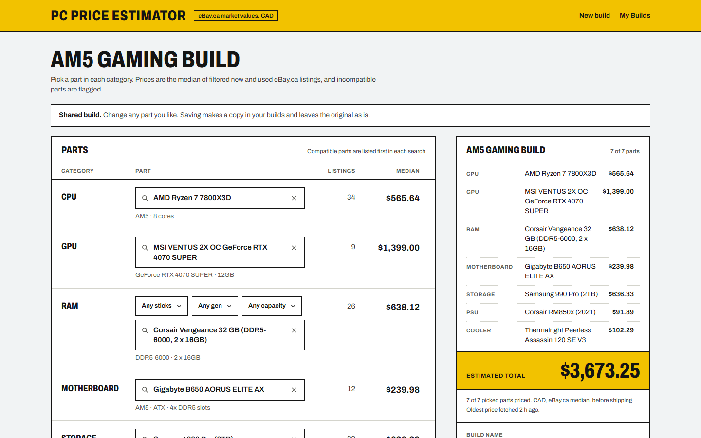
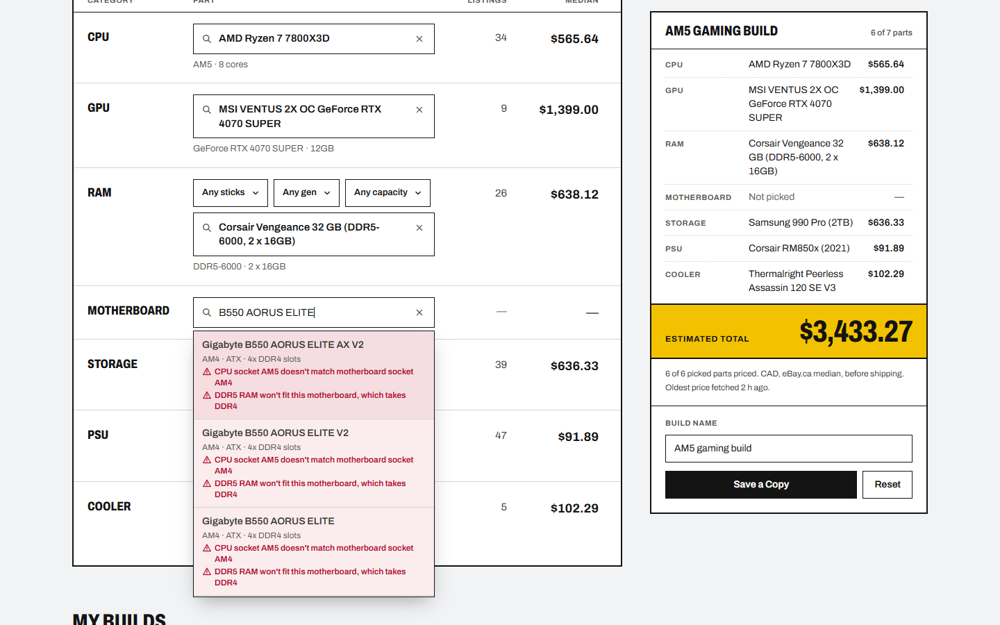
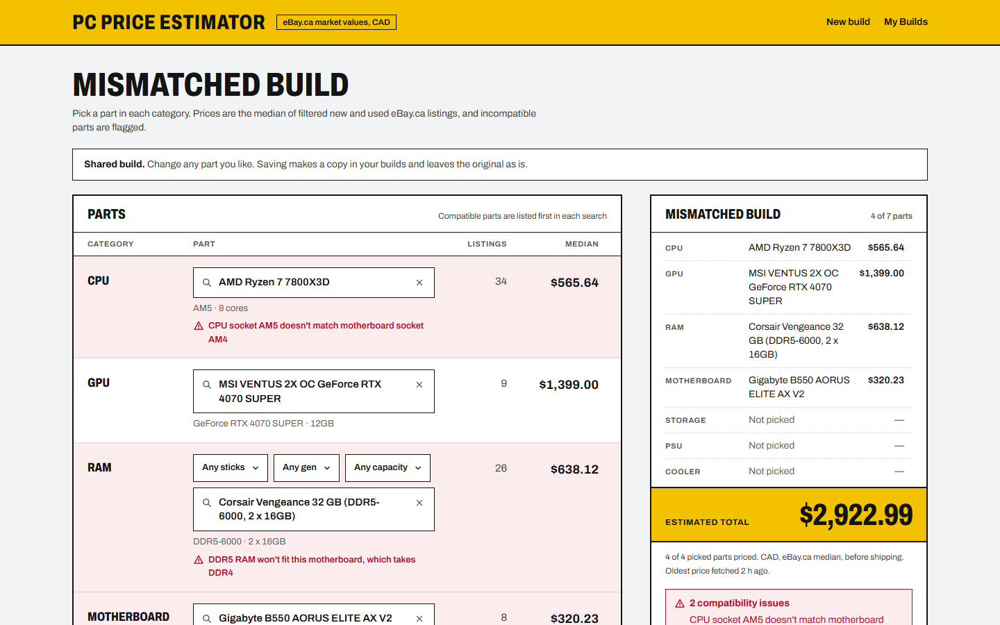
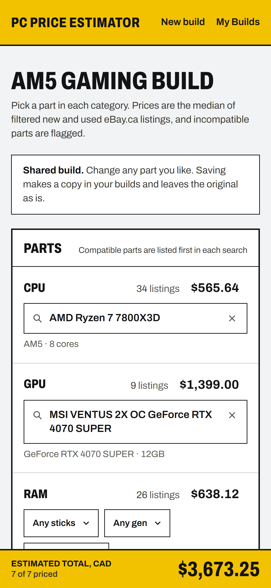

# PC Price Estimator

**Live demo: [pc-price-guide.vercel.app](https://pc-price-guide.vercel.app/)**. Example build: [AM5 gaming build](https://pc-price-guide.vercel.app/build/Ahd4Yyve)

Pick PC parts and see what they actually sell for on eBay Canada. Each part is priced from live eBay.ca listings, filtered and reduced to a median, and the build total updates as you go. The app checks CPU, motherboard and RAM compatibility as you pick, and builds can be saved and shared by link.

It's made for Canadian builders budgeting from the used market, where MSRP lists are no help.



| Incompatible parts are flagged while you search | Conflicts in a build | Phone |
| --- | --- | --- |
|  |  |  |

## Features

- **~31,000 parts** across 7 categories (CPU, GPU, motherboard, RAM, storage, PSU, cooler), with searchable dropdowns and short spec labels.
- **Live eBay.ca prices** in CAD. Each price is the median of matching new and used fixed-price listings, with the listing count and a footnote when a price is thin or stale.
- **Compatibility checks**: CPU socket vs motherboard socket, RAM generation vs motherboard memory type, and RAM stick count vs slots. Incompatible options stay pickable but are flagged with the reason and sorted below compatible ones.
- **Saved builds with share links** (`/build/<id>`), no account needed. The browser that made a build holds a secret edit token. Anyone else who opens the link can change parts and save their own copy, but can't overwrite the original.
- **Mobile layout** with a fixed total bar that hides while the full summary is on screen.

## Tech stack

- **Next.js 16** (App Router, route handlers), **React 19**, **Tailwind CSS 4**
- **PostgreSQL** (Supabase) through **Prisma 6**
- **eBay Browse API** (OAuth client credentials, marketplace `EBAY_CA`)
- **Vitest** + **GitHub Actions** (lint, typecheck, tests on every push)
- Hosted on **Vercel**

## Architecture

```
data/*.json ──(prisma/seed.ts)──► Postgres ──► GET /api/parts?category= ──► Builder.jsx ◄──► localStorage
                                   ▲   ▲                                      │        (owned build ids
                                   │   │ PriceCache   GET /api/price ◄────────┤         + edit tokens)
                                   │   └────────────── price route ──► eBay   │
                                   │                   (6 h cache, per-IP     │
                                   │ Build              limit, daily budget)  │
                                   └────────────────── /api/builds ◄──────────┘
```

- `GET /api/parts?category=cpu` returns one category's parts and specs. It's built once and cached in memory for an hour.
- `GET /api/price?category=cpu&part=…` returns `{ priceCad, listingCount, fetchedAt, stale }`. Only catalog parts can be priced, so the endpoint can't be used to run arbitrary eBay searches.
- `POST /api/builds` creates a build and returns its edit token once. `PATCH` and `DELETE /api/builds/<id>` need `Authorization: Bearer <token>`. Only a SHA-256 hash of the token is stored.

## Interesting problems

**Deriving CPU sockets.** The [dataset](https://github.com/docyx/pc-part-dataset) gives CPUs a microarchitecture but no socket. `cpuSocket()` maps architecture to socket (Zen 4 → AM5, Comet Lake → LGA1200, …). It then refines that by name for the chips an architecture doesn't decide: Threadripper by generation, FX and Opteron, Xeon E5 v1/v2 vs v3/v4, the 2400-series Xeons on LGA1356, and HEDT i7s on LGA1366, LGA2011, LGA2011-3 and LGA2066. Every one of the 1,413 CPUs in the source data gets a known socket.

**The LGA1151 split.** 6th/7th-gen and 8th/9th-gen Intel CPUs use the same physical socket but don't work in each other's boards, and the dataset calls both "LGA1151". CPUs are split into `LGA1151-v1` and `-v2` by architecture. Boards are split by the chipset buried in the product name: `Z270` vs `Z370`, workstation `C236` vs `C246`, Supermicro `X11SS*` vs `X11SC*`, and Asus Maximus `IX` vs `XI`. The few boards that can't be identified accept both.

**Turning eBay results into a fair price.** eBay search is fuzzy, and a raw average was badly skewed. A $15 "box only" listing, a $1,000 listing in "PLC Processors", and an RX 9060 XT showing up for an RX 9070 XT search all got averaged in. The pricing pipeline now:
1. Filters by eBay category, fixed price, and new or used condition, and drops "for parts" listings.
2. Rejects titles with junk words (`box only`, `broken`, `bracket`, `lot`, …) and titles missing any model-number word from the query (`i9-14900K` matches `I9 14900K`).
3. Takes the **median**.
4. Searches North American sellers first, because overseas sellers fill the results with inflated asks. This took an RTX 3070 from $1,404 to $661 and a Noctua NH-D15 from $208 to $134.
5. Falls back to broader queries for GPUs (chipset model) and RAM (no exact speed) when there are fewer than 5 matching listings.

**Protecting the eBay quota.** Prices are cached in Postgres for 6 hours, and concurrent requests for the same part share one lookup. Cache misses are rate limited per IP. A daily call budget in Postgres, shared by every serverless instance, stops eBay calls before the 5,000-call daily quota. When eBay can't be asked, the last known price is served and marked stale.

**Duplicate part names.** The dataset reuses one name for many variants. For example, "Corsair Vengeance LPX 16 GB" covers dozens of speed and kit combinations. `uniqueNames()` appends only the labels that differ within each group, e.g. `Corsair Vengeance LPX 16 GB (DDR4-3200, 2 x 8GB)` and `Samsung 990 Pro (2TB)`, so every variant can be picked and priced on its own.

**Compatible-first search.** While a dropdown is open, every matching option (up to ~8,000 RAM kits) is checked against the rest of the build and stable-sorted so compatible parts come first. This takes about 20 ms in the worst case.

## Running locally

Requirements: Node 20+, a PostgreSQL database, and an [eBay developer](https://developer.ebay.com/) app (production keys).

1. Install:
   ```bash
   npm install
   ```
2. Create `.env` with the database URLs (with Supabase, `DATABASE_URL` is the pooled connection and `DIRECT_URL` the direct one):
   ```
   DATABASE_URL=postgresql://...
   DIRECT_URL=postgresql://...
   ```
3. Create `.env.local` with the eBay keys:
   ```
   EBAY_CLIENT_ID=...
   EBAY_CLIENT_SECRET=...
   ```
4. Create the tables and load the parts. The full seed takes a few minutes:
   ```bash
   npm run db:push
   npm run db:seed
   ```
5. Start the dev server and open http://localhost:3000:
   ```bash
   npm run dev
   ```

On Windows, stop the dev server before `npm install` or `db:push`: it locks the Prisma engine file.

Other scripts: `npm test` (Vitest), `npm run lint`, `npm run typecheck`, `npm run build`.

## Tests

`tests/` covers the pure logic:
- `compatibility.test.js`: the compatibility rules.
- `partSpecs.test.js`: socket derivation, the LGA1151 split, memory types and name deduplication, using real part names from the dataset.
- `pricing.test.js`: the listing filters, median and fallback queries.

CI runs lint, typecheck and tests on every push.

## Limitations

- Prices are asking prices, not sold prices, and don't include shipping or duties. Some parts have only a few listings, and the UI says so.
- There's no cooler socket check (the dataset has no cooler socket data) and no PSU wattage check (no GPU power draw).
- Builds are anonymous. Edit rights live in the creating browser's `localStorage`. Accounts are a possible next step.

## Credits

Part data comes from [docyx/pc-part-dataset](https://github.com/docyx/pc-part-dataset). Prices come from the eBay Browse API. This project isn't affiliated with eBay.
